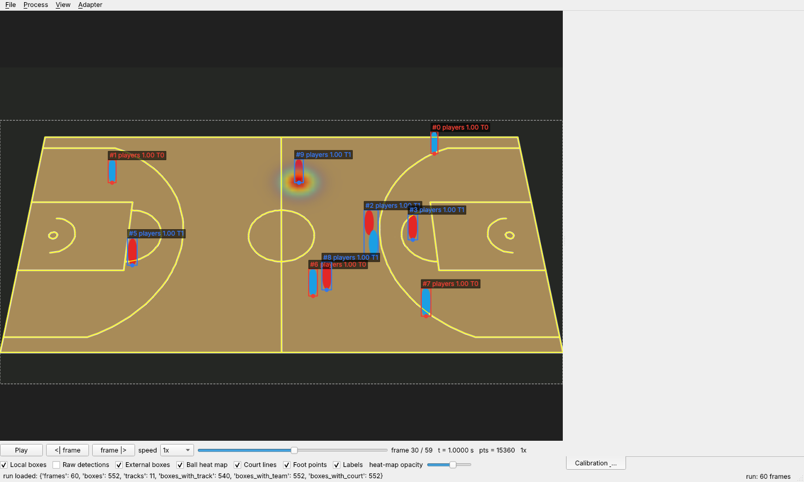

# Basketball Tracking & Research Viewer (btrv)

A local, frame-accurate research viewer for basketball video (HD / 4K / 8K) and tracking data,
produced either by the app itself (Roboflow pinned RF-DETR player model + ByteTrack + court mapping)
or by external research software (boxes, ball heat maps, ball coordinates, SportVU moments).



*Synthetic test scene: local boxes with track ids and team colours, projected court lines from the
calibration, a court-space ball heat map, the ROI (dashed) and the synchronised top-down view.*

## What is in the box

| area | status | where |
|---|---|---|
| Frame-accurate file source (PyAV): pts-based frame index, exact seek, forward/backward stepping, byte-budgeted cache, VFR/B-frames/MKV | verified by tests | `src/btrv/source/` |
| Processing worker: decoder → fixed (ROI) / moving (full frame) → pinned detector → ByteTrack → team colours → court mapping → frame-indexed run on disk | verified end-to-end on synthetic video with a fake detector; real model path implemented, not executed here (needs `ROBOFLOW_API_KEY`) | `src/btrv/pipeline/`, `src/btrv/detect/`, `src/btrv/track/` |
| Detector backends: `roboflow_local` (inference-models, CUDA/MPS/CPU), `roboflow_hosted` (serverless API), `fake`, `boxes_file` | hosted response format captured and unit-tested; local backend code-complete | `src/btrv/detect/` |
| Court model (94×50 ft SportVU frame), manual landmark calibration with RANSAC + confidence, automatic line-based calibration, moving-camera propagation/revalidation, foot-point projection, off-court exclusion | verified on synthetic renders (sub-3 px up to court symmetry); real footage pending | `src/btrv/court/` |
| Team assignment by unsupervised jersey-colour k-means with explicit confidence | verified on synthetic colours | `src/btrv/team/` |
| Interchange: `btrv.boxes` 1.0 (JSONL), `btrv.heatmap` 1.0 (HDF5/NPZ), `btrv.ball` 1.0, `btrv.calibration` 1.0, SportVU conforming + player-only debug export, SportVU import | schema + round-trip + malformed-input tests, examples in `examples/` | `src/btrv/io/`, `docs/schemas.md`, `docs/sportvu.md` |
| Localhost REST + WebSocket adapter with the same schemas | tested with FastAPI test client | `src/btrv/adapter/`, `docs/api.md` |
| PySide6 viewer: video + overlays (local/raw/external boxes, heat map with opacity, court lines, ROI, landmarks), play/pause, 4×/2×/1×/0.5×/0.25×/0.1×, single-frame steps, frame number + pts timestamp, synchronised top-down court window, calibration/ROI panel, processing dialog, imports/exports | offscreen Qt tests for stepping, speeds, overlay sync, imports; interactive use on Linux/macOS/Windows not exercised in this environment | `src/btrv/viewer/` |

Completed-vs-unverified detail: `docs/verification.md`.

## Install

Python 3.10+ (tested on 3.13). FFmpeg libraries come with the PyAV wheels; no system FFmpeg needed.

```bash
python -m venv .venv && source .venv/bin/activate     # Windows: .venv\Scripts\activate
pip install -e ".[dev]"                                # viewer, worker, adapter, tests
pip install -e ".[local-inference]"                    # optional: run the pinned RF-DETR model locally
```

`local-inference` pulls `inference-models` (and torch). For CUDA, install the matching torch wheel first
(`pip install torch --index-url https://download.pytorch.org/whl/cu124`); on Apple Silicon the default
torch wheel provides MPS; CPU works everywhere (slow for 4K/8K). Backend selection is automatic with
manual override (`--compute cuda|mps|cpu`), and the resolved device is written to the run manifest.

Put your Roboflow key in a git-ignored `.env` or the environment: `ROBOFLOW_API_KEY=...`. It is needed
once to download the pinned model weights (local backend) or for every request (hosted backend).

Linux desktops need the usual Qt runtime libraries (`libegl1 libgl1 libxkbcommon0 libxkbcommon-x11-0
libxcb-cursor0 libdbus-1-3 libfontconfig1`); headless CI runs with `QT_QPA_PLATFORM=offscreen`.

## Quick start

```bash
btrv info game.mp4                                   # frame index summary (pts-based timestamps)
btrv-viewer game.mp4                                 # open the viewer (adapter on http://127.0.0.1:8765)
#  -> Calibration & ROI panel: drag an ROI, click >= 4 landmarks, Fit homography, Save calibration
btrv process game.mp4 runs/game01 --camera-mode fixed --roi 100,300,3700,2100 \
     --calibration game.calibration.json --start 1000 --stop 1300 --detector roboflow_local
btrv-viewer game.mp4 --run runs/game01                # boxes, ids, teams, court view
btrv export-boxes runs/game01 tracked.jsonl           # or --raw for detector output
btrv export-sportvu runs/game01 out.json --ball ball.jsonl          # conforming (needs ball coordinates)
btrv export-sportvu runs/game01 debug.json --player-only-debug     # NONSTANDARD, no ball
btrv calibrate-auto game.mp4 auto_cal.json --frame 1000 --roi 100,300,3700,2100
btrv make-examples examples                           # example interchange files
```

`Process > Run processing...` in the viewer does the same from the GUI (progress, cancel, auto-load).
Without model weights you can exercise everything with `--detector fake` on the synthetic scene
produced by `tests/synth.py`.

Keyboard: `Space` play/pause, `←`/`→` step one source frame, `Home`/`End`, mouse wheel zoom,
double-click resets zoom, `0` resets zoom.

## Roboflow assets

* Workspace `bachelor-nozvk`; pinned model `bachelor-nozvk/basketball-player-detection-jwk5o-t33zb-2-rfdetr-small-t1`
  (RF-DETR small, class `players`, mAP50 98.9 on its validation split). The app uses this model id
  directly for both local and hosted inference; it never changes any project's serving model.
* Workflow `Basketball Player Model Comparison` (id `8N8ClrbW7q72knk2RCdb`): inspected through the
  connector on 2026-10-19. Its saved `config` contains only the detector + visualisations; the ByteTrack
  step and the `tracked_players` / `tracked_image` outputs exist only in the draft (`lastVersionConfig`).
  The app therefore does **not** call the Workflow endpoint; tracking runs locally (`trackers` ByteTrack,
  the same implementation behind the Workflow block) with decoded timestamps, which is also what makes
  track state consistent across frames. Hosted inference of the pinned model was verified on a dataset
  image (10 `players` detections, centre-based boxes) — see `tests/test_hosted_parser.py`.
* The *Basketball Tracking Detection* project serves pretrained RF-DETR Nano and is not used.

## Layout

```
src/btrv/core        types, conventions, versions, compute backend
src/btrv/source      FrameSource interface, PyAV FileSource + frame index (live source can be added here)
src/btrv/detect      Detector interface, ROI/resize bookkeeping, Roboflow local/hosted, fake
src/btrv/track       Tracker interface, ByteTrack
src/btrv/team        jersey-colour clustering
src/btrv/court       court model, homography, manual/auto/moving calibration
src/btrv/pipeline    processing worker, config, calibration files
src/btrv/storage     run directory layout, columnar boxes table
src/btrv/io          boxes / heat map / ball / SportVU readers and writers, JSON schemas
src/btrv/adapter     FastAPI REST + WebSocket
src/btrv/viewer      PySide6 application
docs/                coordinates, schemas, sportvu, api, architecture, setup, verification
examples/            example interchange files
tests/               pytest suite (synthetic videos generated with ffmpeg)
```

Run the tests with `pytest` (needs `ffmpeg` on PATH to synthesise test videos).
